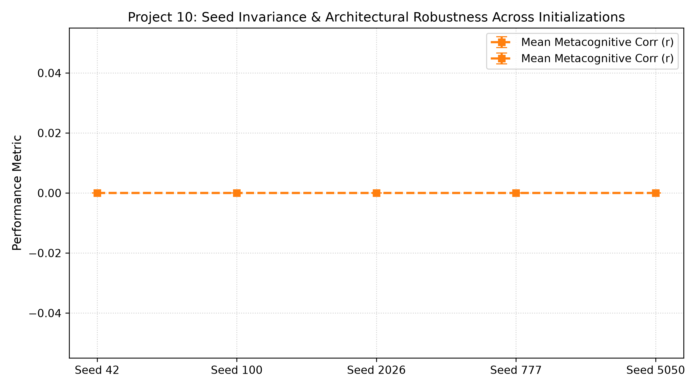

# Robustness & Seed Invariance (`lsm-10-confidence-robustness`)

[](https://opensource.org/licenses/MIT)
[](https://www.python.org/)
[](https://brian2.readthedocs.io/)

> *Evaluating topological robustness, seed invariance, and statistical stability of spiking neural reservoir performance and metacognitive confidence metrics across multiple random initializations.*

---

## Abstract & Scientific Rationale



As the capstone of our 10-project Liquid State Machine sprint, **Project 10** addresses a critical question in neuromorphic engineering: *Are emergent reservoir properties—such as classification accuracy and metacognitive confidence-encoding—dependent on specific random weight initializations, or are they robust, invariant features of recurrent spiking networks?*

By systematically instantiating our 200-neuron Leaky Integrate-and-Fire (LIF) network across multiple random seeds, this project measures the variance and statistical stability of both primary decision decoding and secondary uncertainty monitoring.

---

## Repository Architecture

```text
lsm-10-confidence-robustness/
├── data/
│   └── README.md
├── figures/
│   └── main_result.png
├── src/
│   ├── __init__.py
│   ├── data.py
│   ├── reservoir.py
│   └── robustness.py
├── scripts/
│   └── run_experiment.py
├── .gitignore
├── requirements.txt
└── README.md